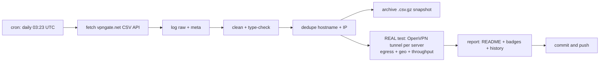

# 🛡️ VPN Gate Monitor

> **Once a day** this repo fetches the complete public [VPN Gate](https://www.vpngate.net/en/) server list, **cleans, deduplicates and archives** it — and then does the part that matters: it **opens a real OpenVPN tunnel to every single listed server**, verifies that traffic genuinely exits through it, checks *where* it exits, and measures real download throughput.
>
> **Everything below this line is the auto-generated living report. No hand-edited numbers.**

[](https://github.com/onlyactions/vpngate-monitor/actions/workflows/vpngate.yml)
[](https://raw.githubusercontent.com/onlyactions/vpngate-monitor/main/badges/servers.json)
[](https://raw.githubusercontent.com/onlyactions/vpngate-monitor/main/badges/alive.json)
[](https://raw.githubusercontent.com/onlyactions/vpngate-monitor/main/badges/speed.json)
[](https://raw.githubusercontent.com/onlyactions/vpngate-monitor/main/badges/updated.json)

## 📊 Latest results

| | |
|---|---|
| **Run** | [#7 · view run](https://github.com/onlyactions/vpngate-monitor/actions/runs/43154396063) · 2026-11-12 04:23:10 UTC · trigger: `schedule` |
| **Servers fetched (unique)** | **93** |
| **Duplicates removed** | 0 exact + 1 same-IP |
| **Servers tested** | **589 of 589** — all 93 current + 496 historical (every server seen in the API within 30 days) |
| **✅ Verified alive** (tunnel up + egress proven) | **272** — 66 from the current list + 206 historical ♻️ |
| **❌ Dead / unusable** | 317 |
| **Usability** | **71.0%** of everything VPN Gate lists right now actually works |
| **⚡ Measured speed (avg / median / max)** | **15.0 / 16.5 / 29.9 Mbps** |
| **🚀 Fastest verified** | **vpn679218486** · 🇯🇵 Japan · **29.9 Mbps** |
| **🧭 Exit-country mismatches** | 0 (server exits somewhere else than it claims) |
| **🤝 Handshake time (alive, avg)** | 3.1 s |

## 🚀 Fastest verified servers

| # | Server | Country | List | Endpoint | Handshake | Measured ↓ | Claimed ↓ | Score |
|---:|---|---|---|---|---:|---:|---:|---:|
| 1 | `vpn679218486` | 🇯🇵 Japan | ♻️ historical | `124.209.226.195:1752`/udp | 2.5s | **29.9 Mbps** | 682.8 Mbps | 683,399 |
| 2 | `vpn714667264` | 🇪🇨 Ecuador | ♻️ historical | `181.199.60.152:6165`/udp | 2.5s | **29.6 Mbps** | 249.4 Mbps | 1,164,909 |
| 3 | `vpn461797036` | 🇯🇵 Japan | 📋 current | `14.11.147.128:16416`/udp | 2.5s | **28.8 Mbps** | 181.0 Mbps | 810,991 |
| 4 | `vpn579347997` | 🇯🇵 Japan | ♻️ historical | `118.240.129.23:1606`/tcp | 2.5s | **27.3 Mbps** | 897.8 Mbps | 903,212 |
| 5 | `vpn255636415` | 🇯🇵 Japan | ♻️ historical | `175.129.113.227:1452`/tcp | 2.0s | **26.8 Mbps** | 919.1 Mbps | 656,434 |
| 6 | `vpn272383655` | 🇯🇵 Japan | ♻️ historical | `222.10.84.11:1903`/tcp | 2.8s | **25.9 Mbps** | 195.7 Mbps | 634,430 |
| 7 | `vpn371090610` | 🇯🇵 Japan | 📋 current | `58.87.159.9:1605`/tcp | 2.5s | **25.7 Mbps** | 591.2 Mbps | 1,499,265 |
| 8 | `vpn500270442` | 🇯🇵 Japan | ♻️ historical | `121.109.224.163:1361`/tcp | 2.8s | **25.4 Mbps** | 545.6 Mbps | 783,585 |
| 9 | `vpn989314839` | 🇯🇵 Japan | ♻️ historical | `211.10.52.110:1729`/tcp | 2.5s | **25.2 Mbps** | 959.3 Mbps | 649,259 |
| 10 | `vpn776438975` | 🇯🇵 Japan | 📋 current | `118.241.179.243:1839`/tcp | 2.5s | **25.1 Mbps** | 116.7 Mbps | 597,765 |

*Measured = 5 MB download through the live tunnel to speed.cloudflare.com. Claimed = the server's self-reported line speed in the VPN Gate API. 'Historical' servers are no longer in the API's current top list but still answered our tunnel — we keep re-testing everything we have ever seen.*

## ⭐ Top-scored & verified alive

| # | Server | Country | Score | Claimed ↓ | Measured ↓ | Sessions | Uptime | Log policy |
|---:|---|---|---:|---:|---:|---:|---:|---|
| 1 | `public-vpn-216` | 🇯🇵 JP | 3,106,309 | 134.5 Mbps | 16.5 Mbps | 94 | 18.9 d | 2weeks |
| 2 | `public-vpn-66` | 🇯🇵 JP | 2,982,274 | 304.6 Mbps | 16.5 Mbps | 95 | 13.9 d | 2weeks |
| 3 | `public-vpn-39` | 🇯🇵 JP | 2,787,871 | 228.2 Mbps | 15.6 Mbps | 137 | 14.9 d | 2weeks |
| 4 | `public-vpn-205` | 🇯🇵 JP | 2,714,062 | 171.1 Mbps | 11.4 Mbps | 92 | 14.9 d | 2weeks |
| 5 | `public-vpn-90` | 🇯🇵 JP | 2,710,460 | 264.5 Mbps | 16.6 Mbps | 173 | 16.9 d | 2weeks |
| 6 | `public-vpn-129` | 🇯🇵 JP | 2,670,601 | 283.0 Mbps | 22.3 Mbps | 44 | 17.9 d | 2weeks |
| 7 | `public-vpn-111` | 🇯🇵 JP | 2,667,320 | 176.8 Mbps | 19.2 Mbps | 33 | 18.9 d | 2weeks |
| 8 | `public-vpn-164` | 🇯🇵 JP | 2,633,438 | 401.5 Mbps | 23.0 Mbps | 74 | 13.9 d | 2weeks |
| 9 | `public-vpn-64` | 🇯🇵 JP | 2,573,246 | 204.4 Mbps | 3.9 Mbps | 53 | 18.9 d | 2weeks |
| 10 | `public-vpn-255` | 🇯🇵 JP | 2,572,871 | 176.4 Mbps | 8.6 Mbps | 138 | 14.9 d | 2weeks |

## 🌍 Countries

| Country | Servers | Verified alive | Best measured ↓ | Fastest server |
|---|---:|---:|---:|---|
| 🇯🇵 Japan (JP) | 282 | 136 | 29.9 Mbps | `vpn679218486` |
| 🇰🇷 Korea Republic of (KR) | 187 | 98 | 22.4 Mbps | `vpn990126810` |
| 🇷🇺 Russian Federation (RU) | 45 | 19 | 19.4 Mbps | `vpn310756240` |
| 🇹🇭 Thailand (TH) | 18 | 2 | 19.8 Mbps | `vpn241487766` |
| 🇺🇸 United States (US) | 17 | 7 | 5.7 Mbps | `vpn250207254` |
| 🇻🇳 Viet Nam (VN) | 7 | 1 | 2.3 Mbps | `vpn560167748` |
| 🇦🇷 Argentina (AR) | 3 | 2 | 20.6 Mbps | `vpn725064175` |
| 🇧🇷 Brazil (BR) | 3 | 1 | 15.3 Mbps | `vpn620588189` |
| 🇮🇳 India (IN) | 3 | 2 | 15.4 Mbps | `vpn759385152` |
| 🇲🇲 Myanmar (MM) | 3 | 0 | 0.0 Mbps | `` |
| 🇦🇺 Australia (AU) | 2 | 0 | 0.0 Mbps | `` |
| 🇧🇾 Belarus (BY) | 2 | 0 | 0.0 Mbps | `` |
| 🇬🇧 United Kingdom (GB) | 2 | 0 | 0.0 Mbps | `` |
| 🇲🇾 Malaysia (MY) | 2 | 0 | 0.0 Mbps | `` |
| 🇹🇼 Taiwan (TW) | 2 | 1 | 13.3 Mbps | `vpn503500791` |
| 🇨🇳 China (CN) | 1 | 1 | 3.6 Mbps | `_unregistered_vpn859862680` |
| 🇨🇴 Colombia (CO) | 1 | 0 | 0.0 Mbps | `` |
| 🇪🇨 Ecuador (EC) | 1 | 1 | 29.6 Mbps | `vpn714667264` |
| 🇮🇩 Indonesia (ID) | 1 | 0 | 0.0 Mbps | `` |
| 🇮🇹 Italy (IT) | 1 | 0 | 0.0 Mbps | `` |
| 🇯🇴 Jordan (JO) | 1 | 0 | 0.0 Mbps | `` |
| 🇲🇽 Mexico (MX) | 1 | 0 | 0.0 Mbps | `` |
| 🇵🇪 Peru (PE) | 1 | 0 | 0.0 Mbps | `` |
| 🇵🇭 Philippines (PH) | 1 | 1 | 6.5 Mbps | `vpn269589023` |
| 🇷🇴 Romania (RO) | 1 | 0 | 0.0 Mbps | `` |
| 🇻🇪 Venezuela (VE) | 1 | 0 | 0.0 Mbps | `` |

## 🕵️ Claim vs. reality

The VPN Gate `Speed` field is whatever the server *claims*. Here is the truth, measured through a live tunnel — the hall of shame (claimed ≫ delivered):

| Server | Country | Claims | Delivers | Reality ratio |
|---|---|---:|---:|---:|
| `vpn624984613` | 🇰🇷 KR | 81 Mbps | 0.1 Mbps | 0% |
| `vpn301434747` | 🇺🇸 US | 139 Mbps | 0.2 Mbps | 0% |
| `vpn859630625` | 🇰🇷 KR | 93 Mbps | 0.2 Mbps | 0% |
| `vpn247849172` | 🇰🇷 KR | 627 Mbps | 1.8 Mbps | 0% |
| `vpn175155645` | 🇯🇵 JP | 38 Mbps | 0.1 Mbps | 0% |
| `public-vpn-219` | 🇯🇵 JP | 232 Mbps | 1.4 Mbps | 1% |
| `vpn519502227` | 🇺🇸 US | 69 Mbps | 0.4 Mbps | 1% |
| `_unregistered_vpn859862680` | 🇨🇳 CN | 531 Mbps | 3.6 Mbps | 1% |
| `vpn986723868` | 🇯🇵 JP | 223 Mbps | 2.1 Mbps | 1% |
| `vpn499499703` | 🇰🇷 KR | 116 Mbps | 1.2 Mbps | 1% |

Most honest of this round: `vpn648203125` (20 Mbps), `vpn501671840` (13 Mbps), `vpn793886241` (19 Mbps), `vpn244093263` (20 Mbps), `vpn484776697` (18 Mbps).

## 🧭 Exit-country mismatches

. ✅ Every verified server exits where it claims.

## 📈 History

Alive % trend (last 17 runs): `██▇▆▆▁▄▅▄▃▄█▄▄▄▄▄`

Avg measured speed (Mbps): `▆▇▁▇▁██▆▁▅▁▆▅▆▆█▇`

| Run at | Fetched | Alive | Alive % | Avg ↓ | Max ↓ | Mismatches |
|---|---:|---:|---:|---:|---:|---:|
| 2026-11-11 04:22:55 UTC | 97 | 234 | 45% | 12.0 | 28.2 | 0 |
| 2026-11-10 04:16:47 UTC | 95 | 205 | 46% | 12.6 | 65.4 | 1 |
| 2026-11-09 04:26:43 UTC | 93 | 164 | 45% | 11.4 | 39.3 | 0 |
| 2026-11-08 04:18:29 UTC | 97 | 134 | 49% | 11.5 | 47.3 | 1 |
| 2026-11-07 04:14:58 UTC | 93 | 88 | 48% | 10.9 | 27.0 | 1 |
| 2026-11-06 09:50:11 UTC | 96 | 69 | 72% | 11.8 | 26.2 | 0 |
| 2026-10-05 14:10:31 UTC | 95 | 434 | 45% | 8.8 | 52.2 | 4 |
| 2026-10-05 05:01:08 UTC | 94 | 394 | 44% | 10.9 | 50.4 | 3 |
| 2026-10-03 16:01:20 UTC | 98 | 368 | 45% | 8.8 | 33.1 | 4 |
| 2026-10-03 11:25:01 UTC | 99 | 388 | 52% | 11.8 | 37.9 | 5 |
| 2026-10-03 04:45:33 UTC | 94 | 322 | 49% | 12.6 | 77.0 | 5 |
| 2026-10-02 22:01:53 UTC | 97 | 164 | 28% | 12.9 | 97.8 | 5 |
| 2026-10-02 05:01:43 UTC | 97 | 289 | 57% | 9.1 | 54.4 | 5 |
| 2026-10-01 05:13:27 UTC | 96 | 248 | 59% | 12.1 | 73.6 | 6 |
| 2026-09-30 04:59:45 UTC | 93 | 214 | 63% | 8.7 | 23.2 | 7 |

## ⚙️ How the pipeline works



1. **Fetch** — `GET /api/iphone/` with retries and endpoint fallback; responses are validated (the API sometimes serves an empty placeholder page to datacenter IPs) and the raw bytes are logged and hashed (sha256).
2. **Clean** — parse the special CSV (`*vpn_servers` marker, `#`-prefixed header), type-check every numeric field, validate IPs, drop broken rows, strip noise.
3. **Dedupe** — remove exact `(HostName, IP)` duplicates, then same-IP entries keeping the highest-scoring one.
4. **Archive** — every run writes an immutable gzipped snapshot to `archive/` (auto-pruned to the newest 360 ≈ 90 days).
5. **Test — the real deal.** For **every** server, every run — not just the API's current list, but **the union of every server that has ever appeared** within the 30-day recall window (kept in `data/known_servers.json`): decode the shared VPN Gate OpenVPN template (all servers ship the same CA + dummy client cert — verified), rebuild each server's config with its remembered `(proto, port)`, force it onto a per-worker `tun` device, disable pushed routes, pin two /32 routes through the tunnel to per-worker Cloudflare anycast IPs, wait for *Initialization Sequence Completed*, then verify egress (`cdn-cgi/trace` through the tunnel must return a foreign exit IP + real exit country) and measure a 5 MB download through the same tunnel. Up to 48 isolated tunnels run in parallel; a server that never completes the handshake is hard-killed after 25 s.
6. **Report** — this README, four live badges, `latest.json`, `summary.json` and the `history.jsonl` log are regenerated and committed by `github-actions[bot]`.

## 📁 Data files & programmatic use

All results are in this repo — hotlink them straight from `https://github.com/onlyactions/vpngate-monitor`:

- [`data/latest.json`](https://raw.githubusercontent.com/onlyactions/vpngate-monitor/main/data/latest.json) — the merged dataset: every cleaned server + its latest real test result
- [`data/servers_clean.csv`](https://raw.githubusercontent.com/onlyactions/vpngate-monitor/main/data/servers_clean.csv) — cleaned, deduplicated server list (no bulky config blobs)
- [`data/summary.json`](https://raw.githubusercontent.com/onlyactions/vpngate-monitor/main/data/summary.json) — compact run summary with failure breakdown
- [`data/history.jsonl`](https://raw.githubusercontent.com/onlyactions/vpngate-monitor/main/data/history.jsonl) — one JSON line per run, append-only
- [`archive/`](https://github.com/onlyactions/vpngate-monitor/tree/main/archive) — immutable gzipped snapshots of every run
- full logs, raw API response and per-server error details are attached to each [Actions run](https://github.com/onlyactions/vpngate-monitor/actions) as artifacts (30-day retention)

Grab a working VPN right now:

```bash
curl -s https://raw.githubusercontent.com/onlyactions/vpngate-monitor/main/data/latest.json \
  | python3 -c "import json,sys;[print(s['IP'],s['CountryShort'],s['test']['download_mbps'],'Mbps') for s in json.load(sys.stdin) if s['test'] and s['test']['alive']]" \
  | sort -k3 -nr | head
```

Field units: `Score` points · `Ping` ms · `Speed` bit/s (self-reported) · `Uptime` ms · `TotalUsers` count · `TotalTraffic` bytes · `download_mbps` Mbps (measured through the tunnel).

## 🔬 Methodology & caveats

- **Real tunnels, not CSV checks.** A server only counts as alive if OpenVPN completed its handshake *and* an HTTPS request bound to the tunnel egressed with a foreign IP. A server whose tunnel silently black-holes traffic fails the egress step and is reported dead.
- **No DNS through the VPN.** Test destinations are pinned with `curl --resolve` to per-worker Cloudflare anycast addresses, so a broken/hijacking VPN DNS can never fake a success.
- **Throughput** is one 5 MB download to `speed.cloudflare.com` through the live tunnel — a sample, not a lab measurement.
- **Vantage point**: GitHub Actions runners (Azure, usually US/EU). A server that is slow from there may be fast from your country, and vice versa.
- **Fairness**: volunteer servers are shared — measured speeds dip when many clients are connected (`NumVpnSessions` is listed).
- **Security**: test traffic is TLS to Cloudflare only; we never send anything sensitive through volunteer servers. Neither should you — assume the operator can see traffic metadata.

## ⚠️ Disclaimer

- [VPN Gate](https://www.vpngate.net/en/) is an academic experiment by the University of Tsukuba, Japan (Daiyuu Nobori & co). This project is an independent monitor of its public API and is **not affiliated** with it.
- VPN servers are run by volunteers; some keep connection logs (see `LogType`). Use them legally and responsibly; do not route anything private or illegal through them.
- Data is provided **as-is** for research/educational purposes.

## 📄 License

Code: MIT. Data: originates from VPN Gate's public API — respect their terms.

---
*Auto-generated by [run #7](https://github.com/onlyactions/vpngate-monitor/actions/runs/43154396063) at 2026-11-12 04:26:47 UTC. Next scheduled run: daily at 03:23 UTC.*
