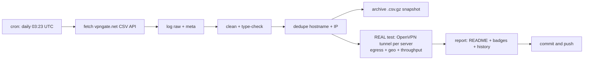

# 🛡️ VPN Gate Monitor

> **Once a day** this repo fetches the complete public [VPN Gate](https://www.vpngate.net/en/) server list, **cleans, deduplicates and archives** it — and then does the part that matters: it **opens a real OpenVPN tunnel to every single listed server**, verifies that traffic genuinely exits through it, checks *where* it exits, and measures real download throughput.
>
> **Everything below this line is the auto-generated living report. No hand-edited numbers.**

[](https://github.com/onlyactions/vpngate-monitor/actions/workflows/vpngate.yml)
[](https://raw.githubusercontent.com/onlyactions/vpngate-monitor/main/badges/servers.json)
[](https://raw.githubusercontent.com/onlyactions/vpngate-monitor/main/badges/alive.json)
[](https://raw.githubusercontent.com/onlyactions/vpngate-monitor/main/badges/speed.json)
[](https://raw.githubusercontent.com/onlyactions/vpngate-monitor/main/badges/updated.json)

## 📊 Latest results

| | |
|---|---|
| **Run** | [#4 · view run](https://github.com/onlyactions/vpngate-monitor/actions/runs/42561819314) · 2026-11-09 04:26:43 UTC · trigger: `schedule` |
| **Servers fetched (unique)** | **93** |
| **Duplicates removed** | 0 exact + 0 same-IP |
| **Servers tested** | **361 of 361** — all 93 current + 268 historical (every server seen in the API within 30 days) |
| **✅ Verified alive** (tunnel up + egress proven) | **164** — 62 from the current list + 102 historical ♻️ |
| **❌ Dead / unusable** | 197 |
| **Usability** | **66.7%** of everything VPN Gate lists right now actually works |
| **⚡ Measured speed (avg / median / max)** | **11.4 / 12.8 / 39.3 Mbps** |
| **🚀 Fastest verified** | **vpn714667264** · 🇪🇨 Ecuador · **39.3 Mbps** |
| **🧭 Exit-country mismatches** | 0 (server exits somewhere else than it claims) |
| **🤝 Handshake time (alive, avg)** | 3.3 s |

## 🚀 Fastest verified servers

| # | Server | Country | List | Endpoint | Handshake | Measured ↓ | Claimed ↓ | Score |
|---:|---|---|---|---|---:|---:|---:|---:|
| 1 | `vpn714667264` | 🇪🇨 Ecuador | 📋 current | `181.199.60.152:6165`/udp | 2.3s | **39.3 Mbps** | 249.4 Mbps | 1,164,909 |
| 2 | `vpn589121690` | 🇻🇪 Venezuela | 📋 current | `154.23.114.34:995`/tcp | 2.3s | **33.2 Mbps** | 227.8 Mbps | 725,438 |
| 3 | `vpn909153861` | 🇯🇵 Japan | 📋 current | `138.64.96.118:14355`/udp | 2.5s | **22.7 Mbps** | 150.1 Mbps | 619,758 |
| 4 | `vpn526062445` | 🇯🇵 Japan | ♻️ historical | `60.143.120.123:1632`/udp | 2.5s | **22.4 Mbps** | 207.5 Mbps | 1,454,780 |
| 5 | `vpn399531613` | 🇯🇵 Japan | 📋 current | `60.109.2.15:1354`/udp | 2.5s | **22.3 Mbps** | 502.7 Mbps | 689,162 |
| 6 | `vpn391570092` | 🇯🇵 Japan | 📋 current | `59.130.14.121:1376`/udp | 2.5s | **21.7 Mbps** | 859.3 Mbps | 704,675 |
| 7 | `vpn459755685` | 🇯🇵 Japan | ♻️ historical | `180.43.107.71:1563`/udp | 2.5s | **20.8 Mbps** | 95.9 Mbps | 625,821 |
| 8 | `vpn683539447` | 🇯🇵 Japan | 📋 current | `61.25.149.161:1708`/udp | 2.3s | **19.7 Mbps** | 94.0 Mbps | 685,601 |
| 9 | `vpn218350102` | 🇯🇵 Japan | 📋 current | `218.41.169.243:1653`/udp | 2.5s | **17.7 Mbps** | 21.9 Mbps | 698,136 |
| 10 | `vpn579347997` | 🇯🇵 Japan | ♻️ historical | `118.240.129.23:1606`/tcp | 3.0s | **16.3 Mbps** | 897.8 Mbps | 903,212 |

*Measured = 5 MB download through the live tunnel to speed.cloudflare.com. Claimed = the server's self-reported line speed in the VPN Gate API. 'Historical' servers are no longer in the API's current top list but still answered our tunnel — we keep re-testing everything we have ever seen.*

## ⭐ Top-scored & verified alive

| # | Server | Country | Score | Claimed ↓ | Measured ↓ | Sessions | Uptime | Log policy |
|---:|---|---|---:|---:|---:|---:|---:|---|
| 1 | `public-vpn-66` | 🇯🇵 JP | 2,982,274 | 304.6 Mbps | 9.8 Mbps | 95 | 13.9 d | 2weeks |
| 2 | `public-vpn-78` | 🇯🇵 JP | 2,853,500 | 294.3 Mbps | 12.8 Mbps | 126 | 14.9 d | 2weeks |
| 3 | `public-vpn-134` | 🇯🇵 JP | 2,748,495 | 241.4 Mbps | 8.3 Mbps | 56 | 14.9 d | 2weeks |
| 4 | `public-vpn-201` | 🇯🇵 JP | 2,718,064 | 163.6 Mbps | 6.3 Mbps | 93 | 14.9 d | 2weeks |
| 5 | `public-vpn-205` | 🇯🇵 JP | 2,714,062 | 171.1 Mbps | 1.4 Mbps | 92 | 14.9 d | 2weeks |
| 6 | `public-vpn-164` | 🇯🇵 JP | 2,633,438 | 401.5 Mbps | 9.9 Mbps | 74 | 13.9 d | 2weeks |
| 7 | `public-vpn-74` | 🇯🇵 JP | 2,630,986 | 231.8 Mbps | 9.7 Mbps | 46 | 14.9 d | 2weeks |
| 8 | `public-vpn-200` | 🇯🇵 JP | 2,590,636 | 196.4 Mbps | 5.2 Mbps | 50 | 13.9 d | 2weeks |
| 9 | `public-vpn-46` | 🇯🇵 JP | 2,534,264 | 206.3 Mbps | 5.5 Mbps | 109 | 14.9 d | 2weeks |
| 10 | `public-vpn-197` | 🇯🇵 JP | 2,478,678 | 192.9 Mbps | 4.2 Mbps | 94 | 15.9 d | 2weeks |

## 🌍 Countries

| Country | Servers | Verified alive | Best measured ↓ | Fastest server |
|---|---:|---:|---:|---|
| 🇯🇵 Japan (JP) | 179 | 91 | 22.7 Mbps | `vpn909153861` |
| 🇰🇷 Korea Republic of (KR) | 116 | 59 | 14.6 Mbps | `vpn701561709` |
| 🇷🇺 Russian Federation (RU) | 21 | 0 | 0.0 Mbps | `` |
| 🇹🇭 Thailand (TH) | 15 | 5 | 16.0 Mbps | `vpn740415697` |
| 🇺🇸 United States (US) | 6 | 1 | 0.2 Mbps | `vpn929520216` |
| 🇻🇳 Viet Nam (VN) | 6 | 1 | 8.0 Mbps | `vpn923730258` |
| 🇦🇷 Argentina (AR) | 2 | 0 | 0.0 Mbps | `` |
| 🇦🇺 Australia (AU) | 2 | 2 | 4.5 Mbps | `vpn139368562` |
| 🇧🇾 Belarus (BY) | 2 | 0 | 0.0 Mbps | `` |
| 🇲🇲 Myanmar (MM) | 2 | 1 | 14.4 Mbps | `vpn477566769` |
| 🇲🇾 Malaysia (MY) | 2 | 0 | 0.0 Mbps | `` |
| 🇧🇷 Brazil (BR) | 1 | 0 | 0.0 Mbps | `` |
| 🇪🇨 Ecuador (EC) | 1 | 1 | 39.3 Mbps | `vpn714667264` |
| 🇬🇧 United Kingdom (GB) | 1 | 1 | 0.4 Mbps | `patito` |
| 🇯🇴 Jordan (JO) | 1 | 0 | 0.0 Mbps | `` |
| 🇲🇽 Mexico (MX) | 1 | 0 | 0.0 Mbps | `` |
| 🇵🇭 Philippines (PH) | 1 | 1 | 4.8 Mbps | `vpn269589023` |
| 🇷🇴 Romania (RO) | 1 | 0 | 0.0 Mbps | `` |
| 🇻🇪 Venezuela (VE) | 1 | 1 | 33.2 Mbps | `vpn589121690` |

## 🕵️ Claim vs. reality

The VPN Gate `Speed` field is whatever the server *claims*. Here is the truth, measured through a live tunnel — the hall of shame (claimed ≫ delivered):

| Server | Country | Claims | Delivers | Reality ratio |
|---|---|---:|---:|---:|
| `vpn838701359` | 🇯🇵 JP | 75 Mbps | 0.0 Mbps | 0% |
| `vpn434008438` | 🇯🇵 JP | 168 Mbps | 0.3 Mbps | 0% |
| `vpn929520216` | 🇺🇸 US | 44 Mbps | 0.2 Mbps | 0% |
| `vpn177768996` | 🇯🇵 JP | 2,402 Mbps | 14.8 Mbps | 1% |
| `vpn750706241` | 🇯🇵 JP | 326 Mbps | 2.4 Mbps | 1% |
| `public-vpn-205` | 🇯🇵 JP | 171 Mbps | 1.4 Mbps | 1% |
| `public-vpn-198` | 🇯🇵 JP | 556 Mbps | 5.9 Mbps | 1% |
| `public-vpn-119` | 🇯🇵 JP | 752 Mbps | 8.1 Mbps | 1% |
| `public-vpn-223` | 🇯🇵 JP | 200 Mbps | 2.5 Mbps | 1% |
| `public-vpn-261` | 🇯🇵 JP | 319 Mbps | 4.1 Mbps | 1% |

Most honest of this round: `vpn648203125` (14 Mbps), `vpn501671840` (11 Mbps), `vpn701561709` (15 Mbps), `vpn484776697` (14 Mbps), `vpn757870457` (9 Mbps).

## 🧭 Exit-country mismatches

. ✅ Every verified server exits where it claims.

## 📈 History

Alive % trend (last 14 runs): `██▇▆▆▁▄▅▄▃▄█▄▄`

Avg measured speed (Mbps): `▆▇▁▇▁██▆▁▅▁▆▅▆`

| Run at | Fetched | Alive | Alive % | Avg ↓ | Max ↓ | Mismatches |
|---|---:|---:|---:|---:|---:|---:|
| 2026-11-08 04:18:29 UTC | 97 | 134 | 49% | 11.5 | 47.3 | 1 |
| 2026-11-07 04:14:58 UTC | 93 | 88 | 48% | 10.9 | 27.0 | 1 |
| 2026-11-06 09:50:11 UTC | 96 | 69 | 72% | 11.8 | 26.2 | 0 |
| 2026-10-05 14:10:31 UTC | 95 | 434 | 45% | 8.8 | 52.2 | 4 |
| 2026-10-05 05:01:08 UTC | 94 | 394 | 44% | 10.9 | 50.4 | 3 |
| 2026-10-03 16:01:20 UTC | 98 | 368 | 45% | 8.8 | 33.1 | 4 |
| 2026-10-03 11:25:01 UTC | 99 | 388 | 52% | 11.8 | 37.9 | 5 |
| 2026-10-03 04:45:33 UTC | 94 | 322 | 49% | 12.6 | 77.0 | 5 |
| 2026-10-02 22:01:53 UTC | 97 | 164 | 28% | 12.9 | 97.8 | 5 |
| 2026-10-02 05:01:43 UTC | 97 | 289 | 57% | 9.1 | 54.4 | 5 |
| 2026-10-01 05:13:27 UTC | 96 | 248 | 59% | 12.1 | 73.6 | 6 |
| 2026-09-30 04:59:45 UTC | 93 | 214 | 63% | 8.7 | 23.2 | 7 |
| 2026-09-29 04:50:31 UTC | 91 | 191 | 73% | 11.9 | 80.1 | 3 |
| 2026-09-29 04:45:58 UTC | 93 | 126 | 70% | 11.4 | 53.6 | 2 |

## ⚙️ How the pipeline works



1. **Fetch** — `GET /api/iphone/` with retries and endpoint fallback; responses are validated (the API sometimes serves an empty placeholder page to datacenter IPs) and the raw bytes are logged and hashed (sha256).
2. **Clean** — parse the special CSV (`*vpn_servers` marker, `#`-prefixed header), type-check every numeric field, validate IPs, drop broken rows, strip noise.
3. **Dedupe** — remove exact `(HostName, IP)` duplicates, then same-IP entries keeping the highest-scoring one.
4. **Archive** — every run writes an immutable gzipped snapshot to `archive/` (auto-pruned to the newest 360 ≈ 90 days).
5. **Test — the real deal.** For **every** server, every run — not just the API's current list, but **the union of every server that has ever appeared** within the 30-day recall window (kept in `data/known_servers.json`): decode the shared VPN Gate OpenVPN template (all servers ship the same CA + dummy client cert — verified), rebuild each server's config with its remembered `(proto, port)`, force it onto a per-worker `tun` device, disable pushed routes, pin two /32 routes through the tunnel to per-worker Cloudflare anycast IPs, wait for *Initialization Sequence Completed*, then verify egress (`cdn-cgi/trace` through the tunnel must return a foreign exit IP + real exit country) and measure a 5 MB download through the same tunnel. Up to 48 isolated tunnels run in parallel; a server that never completes the handshake is hard-killed after 25 s.
6. **Report** — this README, four live badges, `latest.json`, `summary.json` and the `history.jsonl` log are regenerated and committed by `github-actions[bot]`.

## 📁 Data files & programmatic use

All results are in this repo — hotlink them straight from `https://github.com/onlyactions/vpngate-monitor`:

- [`data/latest.json`](https://raw.githubusercontent.com/onlyactions/vpngate-monitor/main/data/latest.json) — the merged dataset: every cleaned server + its latest real test result
- [`data/servers_clean.csv`](https://raw.githubusercontent.com/onlyactions/vpngate-monitor/main/data/servers_clean.csv) — cleaned, deduplicated server list (no bulky config blobs)
- [`data/summary.json`](https://raw.githubusercontent.com/onlyactions/vpngate-monitor/main/data/summary.json) — compact run summary with failure breakdown
- [`data/history.jsonl`](https://raw.githubusercontent.com/onlyactions/vpngate-monitor/main/data/history.jsonl) — one JSON line per run, append-only
- [`archive/`](https://github.com/onlyactions/vpngate-monitor/tree/main/archive) — immutable gzipped snapshots of every run
- full logs, raw API response and per-server error details are attached to each [Actions run](https://github.com/onlyactions/vpngate-monitor/actions) as artifacts (30-day retention)

Grab a working VPN right now:

```bash
curl -s https://raw.githubusercontent.com/onlyactions/vpngate-monitor/main/data/latest.json \
  | python3 -c "import json,sys;[print(s['IP'],s['CountryShort'],s['test']['download_mbps'],'Mbps') for s in json.load(sys.stdin) if s['test'] and s['test']['alive']]" \
  | sort -k3 -nr | head
```

Field units: `Score` points · `Ping` ms · `Speed` bit/s (self-reported) · `Uptime` ms · `TotalUsers` count · `TotalTraffic` bytes · `download_mbps` Mbps (measured through the tunnel).

## 🔬 Methodology & caveats

- **Real tunnels, not CSV checks.** A server only counts as alive if OpenVPN completed its handshake *and* an HTTPS request bound to the tunnel egressed with a foreign IP. A server whose tunnel silently black-holes traffic fails the egress step and is reported dead.
- **No DNS through the VPN.** Test destinations are pinned with `curl --resolve` to per-worker Cloudflare anycast addresses, so a broken/hijacking VPN DNS can never fake a success.
- **Throughput** is one 5 MB download to `speed.cloudflare.com` through the live tunnel — a sample, not a lab measurement.
- **Vantage point**: GitHub Actions runners (Azure, usually US/EU). A server that is slow from there may be fast from your country, and vice versa.
- **Fairness**: volunteer servers are shared — measured speeds dip when many clients are connected (`NumVpnSessions` is listed).
- **Security**: test traffic is TLS to Cloudflare only; we never send anything sensitive through volunteer servers. Neither should you — assume the operator can see traffic metadata.

## ⚠️ Disclaimer

- [VPN Gate](https://www.vpngate.net/en/) is an academic experiment by the University of Tsukuba, Japan (Daiyuu Nobori & co). This project is an independent monitor of its public API and is **not affiliated** with it.
- VPN servers are run by volunteers; some keep connection logs (see `LogType`). Use them legally and responsibly; do not route anything private or illegal through them.
- Data is provided **as-is** for research/educational purposes.

## 📄 License

Code: MIT. Data: originates from VPN Gate's public API — respect their terms.

---
*Auto-generated by [run #4](https://github.com/onlyactions/vpngate-monitor/actions/runs/42561819314) at 2026-11-09 04:28:55 UTC. Next scheduled run: daily at 03:23 UTC.*
