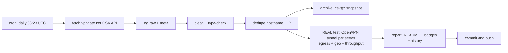

# 🛡️ VPN Gate Monitor

> **Once a day** this repo fetches the complete public [VPN Gate](https://www.vpngate.net/en/) server list, **cleans, deduplicates and archives** it — and then does the part that matters: it **opens a real OpenVPN tunnel to every single listed server**, verifies that traffic genuinely exits through it, checks *where* it exits, and measures real download throughput.
>
> **Everything below this line is the auto-generated living report. No hand-edited numbers.**

[](https://github.com/onlyactions/vpngate-monitor/actions/workflows/vpngate.yml)
[](https://raw.githubusercontent.com/onlyactions/vpngate-monitor/main/badges/servers.json)
[](https://raw.githubusercontent.com/onlyactions/vpngate-monitor/main/badges/alive.json)
[](https://raw.githubusercontent.com/onlyactions/vpngate-monitor/main/badges/speed.json)
[](https://raw.githubusercontent.com/onlyactions/vpngate-monitor/main/badges/updated.json)

## 📊 Latest results

| | |
|---|---|
| **Run** | [#17 · view run](https://github.com/onlyactions/vpngate-monitor/actions/runs/44984683994) · 2026-11-22 04:22:09 UTC · trigger: `schedule` |
| **Servers fetched (unique)** | **95** |
| **Duplicates removed** | 0 exact + 0 same-IP |
| **Servers tested** | **1,269 of 1,269** — all 95 current + 1,174 historical (every server seen in the API within 30 days) |
| **✅ Verified alive** (tunnel up + egress proven) | **445** — 67 from the current list + 378 historical ♻️ |
| **❌ Dead / unusable** | 824 |
| **Usability** | **70.5%** of everything VPN Gate lists right now actually works |
| **⚡ Measured speed (avg / median / max)** | **12.3 / 14.3 / 35.6 Mbps** |
| **🚀 Fastest verified** | **vpn491348575** · 🇨🇦 Canada · **35.6 Mbps** |
| **🧭 Exit-country mismatches** | 2 (server exits somewhere else than it claims) |
| **🤝 Handshake time (alive, avg)** | 2.8 s |

## 🚀 Fastest verified servers

| # | Server | Country | List | Endpoint | Handshake | Measured ↓ | Claimed ↓ | Score |
|---:|---|---|---|---|---:|---:|---:|---:|
| 1 | `vpn491348575` | 🇨🇦 Canada | ♻️ historical | `184.68.30.116:1697`/tcp | 1.5s | **35.6 Mbps** | 17.4 Mbps | 1,154,690 |
| 2 | `vpn482888807` | 🇯🇵 Japan | ♻️ historical | `223.132.1.215:1195`/udp | 2.0s | **29.4 Mbps** | 925.0 Mbps | 1,156,381 |
| 3 | `vpn189019752` | 🇯🇵 Japan | ♻️ historical | `131.147.36.66:1195`/udp | 1.8s | **28.9 Mbps** | 932.1 Mbps | 610,142 |
| 4 | `vpn679218486` | 🇯🇵 Japan | ♻️ historical | `124.209.226.195:1752`/udp | 2.5s | **28.5 Mbps** | 682.8 Mbps | 683,399 |
| 5 | `vpn649976307` | 🇯🇵 Japan | ♻️ historical | `163.58.83.64:1822`/udp | 2.0s | **28.2 Mbps** | 319.8 Mbps | 586,080 |
| 6 | `vpn939813472` | 🇯🇵 Japan | ♻️ historical | `138.64.83.11:23875`/udp | 1.8s | **27.8 Mbps** | 598.6 Mbps | 579,285 |
| 7 | `vpn831230332` | 🇯🇵 Japan | 📋 current | `147.192.140.77:1195`/udp | 2.0s | **27.5 Mbps** | 957.6 Mbps | 702,065 |
| 8 | `vpn515713847` | 🇯🇵 Japan | 📋 current | `130.62.160.64:54798`/udp | 2.5s | **26.6 Mbps** | 275.1 Mbps | 649,841 |
| 9 | `vpn399531613` | 🇯🇵 Japan | ♻️ historical | `60.109.2.15:1354`/udp | 1.8s | **26.1 Mbps** | 502.7 Mbps | 689,162 |
| 10 | `vpn371974639` | 🇯🇵 Japan | ♻️ historical | `131.129.252.232:61480`/udp | 2.0s | **24.0 Mbps** | 91.7 Mbps | 629,048 |

*Measured = 5 MB download through the live tunnel to speed.cloudflare.com. Claimed = the server's self-reported line speed in the VPN Gate API. 'Historical' servers are no longer in the API's current top list but still answered our tunnel — we keep re-testing everything we have ever seen.*

## ⭐ Top-scored & verified alive

| # | Server | Country | Score | Claimed ↓ | Measured ↓ | Sessions | Uptime | Log policy |
|---:|---|---|---:|---:|---:|---:|---:|---|
| 1 | `public-vpn-229` | 🇯🇵 JP | 2,884,619 | 131.0 Mbps | 11.5 Mbps | 115 | 26.9 d | 2weeks |
| 2 | `public-vpn-202` | 🇯🇵 JP | 2,849,321 | 236.5 Mbps | 11.3 Mbps | 78 | 23.9 d | 2weeks |
| 3 | `public-vpn-206` | 🇯🇵 JP | 2,825,566 | 328.0 Mbps | 0.6 Mbps | 70 | 20.9 d | 2weeks |
| 4 | `public-vpn-39` | 🇯🇵 JP | 2,787,871 | 228.2 Mbps | 14.9 Mbps | 137 | 14.9 d | 2weeks |
| 5 | `public-vpn-95` | 🇯🇵 JP | 2,779,114 | 1,163.6 Mbps | 8.7 Mbps | 256 | 24.9 d | 2weeks |
| 6 | `public-vpn-251` | 🇯🇵 JP | 2,776,080 | 101.8 Mbps | 6.3 Mbps | 92 | 23.9 d | 2weeks |
| 7 | `public-vpn-164` | 🇯🇵 JP | 2,732,238 | 201.4 Mbps | 15.2 Mbps | 93 | 20.9 d | 2weeks |
| 8 | `public-vpn-205` | 🇯🇵 JP | 2,714,062 | 171.1 Mbps | 7.2 Mbps | 92 | 14.9 d | 2weeks |
| 9 | `public-vpn-52` | 🇯🇵 JP | 2,695,814 | 415.8 Mbps | 15.8 Mbps | 148 | 16.9 d | 2weeks |
| 10 | `public-vpn-156` | 🇯🇵 JP | 2,686,811 | 238.3 Mbps | 14.8 Mbps | 74 | 26.9 d | 2weeks |

## 🌍 Countries

| Country | Servers | Verified alive | Best measured ↓ | Fastest server |
|---|---:|---:|---:|---|
| 🇯🇵 Japan (JP) | 595 | 245 | 29.4 Mbps | `vpn482888807` |
| 🇰🇷 Korea Republic of (KR) | 411 | 159 | 20.2 Mbps | `vpn980000522` |
| 🇷🇺 Russian Federation (RU) | 99 | 16 | 15.6 Mbps | `vpn528714750` |
| 🇹🇭 Thailand (TH) | 47 | 4 | 17.5 Mbps | `vpn580612947` |
| 🇺🇸 United States (US) | 32 | 6 | 8.4 Mbps | `vpn167953711` |
| 🇻🇳 Viet Nam (VN) | 17 | 0 | 0.0 Mbps | `` |
| 🇦🇷 Argentina (AR) | 5 | 0 | 0.0 Mbps | `` |
| 🇦🇺 Australia (AU) | 5 | 1 | 0.7 Mbps | `vpn618946778` |
| 🇧🇷 Brazil (BR) | 5 | 0 | 0.0 Mbps | `` |
| 🇮🇩 Indonesia (ID) | 4 | 2 | 14.0 Mbps | `vpn104-cyberdewata` |
| 🇵🇪 Peru (PE) | 4 | 0 | 0.0 Mbps | `` |
| 🇬🇧 United Kingdom (GB) | 3 | 0 | 0.0 Mbps | `` |
| 🇮🇳 India (IN) | 3 | 1 | 9.3 Mbps | `vpn359610091` |
| 🇲🇲 Myanmar (MM) | 3 | 0 | 0.0 Mbps | `` |
| 🇦🇪 United Arab Emirates (AE) | 2 | 0 | 0.0 Mbps | `` |
| 🇧🇾 Belarus (BY) | 2 | 0 | 0.0 Mbps | `` |
| 🇨🇦 Canada (CA) | 2 | 1 | 35.6 Mbps | `vpn491348575` |
| 🇨🇳 China (CN) | 2 | 0 | 0.0 Mbps | `` |
| 🇪🇨 Ecuador (EC) | 2 | 1 | 20.1 Mbps | `vpn800617869` |
| 🇭🇰 Hong Kong (HK) | 2 | 1 | 0.8 Mbps | `vpn942711940` |
| 🇭🇷 Croatia (LOCAL Name: Hrvatska) (HR) | 2 | 2 | 0.8 Mbps | `vpn962496160` |
| 🇲🇽 Mexico (MX) | 2 | 2 | 16.6 Mbps | `vpn678204705` |
| 🇲🇾 Malaysia (MY) | 2 | 0 | 0.0 Mbps | `` |
| 🇳🇿 New Zealand (NZ) | 2 | 1 | 23.6 Mbps | `vpn640114063` |
| 🇵🇦 Panama (PA) | 2 | 1 | 6.6 Mbps | `vpn743273359` |
| 🇵🇭 Philippines (PH) | 2 | 0 | 0.0 Mbps | `` |
| 🇹🇼 Taiwan (TW) | 2 | 1 | 0.8 Mbps | `vpn503500791` |
| 🇨🇴 Colombia (CO) | 1 | 0 | 0.0 Mbps | `` |
| 🇫🇷 France (FR) | 1 | 0 | 0.0 Mbps | `` |
| 🇬🇩 Grenada (GD) | 1 | 1 | 3.2 Mbps | `diamondgnd` |
| 🇮🇹 Italy (IT) | 1 | 0 | 0.0 Mbps | `` |
| 🇯🇴 Jordan (JO) | 1 | 0 | 0.0 Mbps | `` |
| 🇳🇱 Netherlands (NL) | 1 | 0 | 0.0 Mbps | `` |
| 🇵🇸 Palestinian Territory Occupied (PS) | 1 | 0 | 0.0 Mbps | `` |
| 🇵🇹 Portugal (PT) | 1 | 0 | 0.0 Mbps | `` |
| 🇷🇴 Romania (RO) | 1 | 0 | 0.0 Mbps | `` |
| 🇻🇪 Venezuela (VE) | 1 | 0 | 0.0 Mbps | `` |

## 🕵️ Claim vs. reality

The VPN Gate `Speed` field is whatever the server *claims*. Here is the truth, measured through a live tunnel — the hall of shame (claimed ≫ delivered):

| Server | Country | Claims | Delivers | Reality ratio |
|---|---|---:|---:|---:|
| `vpn981288372` | 🇯🇵 JP | 237 Mbps | 0.0 Mbps | 0% |
| `vpn949825988` | 🇯🇵 JP | 260 Mbps | 0.2 Mbps | 0% |
| `vpn656949650` | 🇯🇵 JP | 764 Mbps | 0.9 Mbps | 0% |
| `vpn618946778` | 🇦🇺 AU | 493 Mbps | 0.7 Mbps | 0% |
| `public-vpn-206` | 🇯🇵 JP | 328 Mbps | 0.6 Mbps | 0% |
| `vpn290308527` | 🇯🇵 JP | 262 Mbps | 0.6 Mbps | 0% |
| `vpn239083808` | 🇯🇵 JP | 571 Mbps | 1.2 Mbps | 0% |
| `vpn805797245` | 🇰🇷 KR | 448 Mbps | 1.0 Mbps | 0% |
| `vpn750706241` | 🇯🇵 JP | 332 Mbps | 0.9 Mbps | 0% |
| `vpn409198720` | 🇯🇵 JP | 236 Mbps | 0.7 Mbps | 0% |

Most honest of this round: `vpn501671840` (11 Mbps), `vpn491348575` (36 Mbps), `vpn244093263` (15 Mbps), `vpn324168628` (18 Mbps), `vpn799057875` (12 Mbps).

## 🧭 Exit-country mismatches

These servers are listed under one country but your traffic **actually exits somewhere else** (verified via Cloudflare's geo view of the exit IP) — useful to know before you trust one:

| Server | Claims | Actually exits via | Exit IP | Measured ↓ |
|---|---|---|---|---:|
| `vpn962496160` | 🇭🇷 HR | 🇧🇬 BG | `150.40.105.24` | 0.8 Mbps |
| `vpn457795651` | 🇭🇷 HR | 🇧🇬 BG | `150.40.105.20` | 0.7 Mbps |

## 📈 History

Alive % trend (last 27 runs): `██▇▆▆▁▄▅▄▃▄█▄▄▄▄▄▄▃▃▃▃▃▂▃▂▂`

Avg measured speed (Mbps): `▄▅▁▅▁▆▅▄▁▃▁▄▃▄▄▅▅██▄▅█▃▇▄▂▅`

| Run at | Fetched | Alive | Alive % | Avg ↓ | Max ↓ | Mismatches |
|---|---:|---:|---:|---:|---:|---:|
| 2026-11-21 04:18:18 UTC | 93 | 435 | 36% | 12.0 | 28.8 | 2 |
| 2026-11-20 04:21:47 UTC | 93 | 436 | 38% | 9.8 | 39.0 | 2 |
| 2026-11-19 04:25:57 UTC | 95 | 429 | 40% | 11.4 | 47.3 | 3 |
| 2026-11-18 04:22:25 UTC | 92 | 389 | 39% | 14.2 | 37.8 | 2 |
| 2026-11-17 04:21:05 UTC | 98 | 397 | 42% | 11.0 | 26.6 | 3 |
| 2026-11-16 04:58:07 UTC | 94 | 366 | 42% | 14.3 | 35.9 | 1 |
| 2026-11-15 04:20:41 UTC | 90 | 334 | 41% | 12.4 | 29.8 | 0 |
| 2026-11-14 04:17:29 UTC | 98 | 323 | 44% | 11.3 | 54.8 | 2 |
| 2026-11-13 04:22:35 UTC | 97 | 295 | 44% | 14.9 | 46.8 | 1 |
| 2026-11-12 04:23:10 UTC | 93 | 272 | 46% | 15.0 | 29.9 | 0 |
| 2026-11-11 04:22:55 UTC | 97 | 234 | 45% | 12.0 | 28.2 | 0 |
| 2026-11-10 04:16:47 UTC | 95 | 205 | 46% | 12.6 | 65.4 | 1 |
| 2026-11-09 04:26:43 UTC | 93 | 164 | 45% | 11.4 | 39.3 | 0 |
| 2026-11-08 04:18:29 UTC | 97 | 134 | 49% | 11.5 | 47.3 | 1 |
| 2026-11-07 04:14:58 UTC | 93 | 88 | 48% | 10.9 | 27.0 | 1 |

## ⚙️ How the pipeline works



1. **Fetch** — `GET /api/iphone/` with retries and endpoint fallback; responses are validated (the API sometimes serves an empty placeholder page to datacenter IPs) and the raw bytes are logged and hashed (sha256).
2. **Clean** — parse the special CSV (`*vpn_servers` marker, `#`-prefixed header), type-check every numeric field, validate IPs, drop broken rows, strip noise.
3. **Dedupe** — remove exact `(HostName, IP)` duplicates, then same-IP entries keeping the highest-scoring one.
4. **Archive** — every run writes an immutable gzipped snapshot to `archive/` (auto-pruned to the newest 360 ≈ 90 days).
5. **Test — the real deal.** For **every** server, every run — not just the API's current list, but **the union of every server that has ever appeared** within the 30-day recall window (kept in `data/known_servers.json`): decode the shared VPN Gate OpenVPN template (all servers ship the same CA + dummy client cert — verified), rebuild each server's config with its remembered `(proto, port)`, force it onto a per-worker `tun` device, disable pushed routes, pin two /32 routes through the tunnel to per-worker Cloudflare anycast IPs, wait for *Initialization Sequence Completed*, then verify egress (`cdn-cgi/trace` through the tunnel must return a foreign exit IP + real exit country) and measure a 5 MB download through the same tunnel. Up to 48 isolated tunnels run in parallel; a server that never completes the handshake is hard-killed after 25 s.
6. **Report** — this README, four live badges, `latest.json`, `summary.json` and the `history.jsonl` log are regenerated and committed by `github-actions[bot]`.

## 📁 Data files & programmatic use

All results are in this repo — hotlink them straight from `https://github.com/onlyactions/vpngate-monitor`:

- [`data/latest.json`](https://raw.githubusercontent.com/onlyactions/vpngate-monitor/main/data/latest.json) — the merged dataset: every cleaned server + its latest real test result
- [`data/servers_clean.csv`](https://raw.githubusercontent.com/onlyactions/vpngate-monitor/main/data/servers_clean.csv) — cleaned, deduplicated server list (no bulky config blobs)
- [`data/summary.json`](https://raw.githubusercontent.com/onlyactions/vpngate-monitor/main/data/summary.json) — compact run summary with failure breakdown
- [`data/history.jsonl`](https://raw.githubusercontent.com/onlyactions/vpngate-monitor/main/data/history.jsonl) — one JSON line per run, append-only
- [`archive/`](https://github.com/onlyactions/vpngate-monitor/tree/main/archive) — immutable gzipped snapshots of every run
- full logs, raw API response and per-server error details are attached to each [Actions run](https://github.com/onlyactions/vpngate-monitor/actions) as artifacts (30-day retention)

Grab a working VPN right now:

```bash
curl -s https://raw.githubusercontent.com/onlyactions/vpngate-monitor/main/data/latest.json \
  | python3 -c "import json,sys;[print(s['IP'],s['CountryShort'],s['test']['download_mbps'],'Mbps') for s in json.load(sys.stdin) if s['test'] and s['test']['alive']]" \
  | sort -k3 -nr | head
```

Field units: `Score` points · `Ping` ms · `Speed` bit/s (self-reported) · `Uptime` ms · `TotalUsers` count · `TotalTraffic` bytes · `download_mbps` Mbps (measured through the tunnel).

## 🔬 Methodology & caveats

- **Real tunnels, not CSV checks.** A server only counts as alive if OpenVPN completed its handshake *and* an HTTPS request bound to the tunnel egressed with a foreign IP. A server whose tunnel silently black-holes traffic fails the egress step and is reported dead.
- **No DNS through the VPN.** Test destinations are pinned with `curl --resolve` to per-worker Cloudflare anycast addresses, so a broken/hijacking VPN DNS can never fake a success.
- **Throughput** is one 5 MB download to `speed.cloudflare.com` through the live tunnel — a sample, not a lab measurement.
- **Vantage point**: GitHub Actions runners (Azure, usually US/EU). A server that is slow from there may be fast from your country, and vice versa.
- **Fairness**: volunteer servers are shared — measured speeds dip when many clients are connected (`NumVpnSessions` is listed).
- **Security**: test traffic is TLS to Cloudflare only; we never send anything sensitive through volunteer servers. Neither should you — assume the operator can see traffic metadata.

## ⚠️ Disclaimer

- [VPN Gate](https://www.vpngate.net/en/) is an academic experiment by the University of Tsukuba, Japan (Daiyuu Nobori & co). This project is an independent monitor of its public API and is **not affiliated** with it.
- VPN servers are run by volunteers; some keep connection logs (see `LogType`). Use them legally and responsibly; do not route anything private or illegal through them.
- Data is provided **as-is** for research/educational purposes.

## 📄 License

Code: MIT. Data: originates from VPN Gate's public API — respect their terms.

---
*Auto-generated by [run #17](https://github.com/onlyactions/vpngate-monitor/actions/runs/44984683994) at 2026-11-22 04:30:05 UTC. Next scheduled run: daily at 03:23 UTC.*
