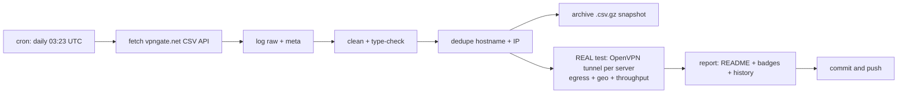

# 🛡️ VPN Gate Monitor

> **Once a day** this repo fetches the complete public [VPN Gate](https://www.vpngate.net/en/) server list, **cleans, deduplicates and archives** it — and then does the part that matters: it **opens a real OpenVPN tunnel to every single listed server**, verifies that traffic genuinely exits through it, checks *where* it exits, and measures real download throughput.
>
> **Everything below this line is the auto-generated living report. No hand-edited numbers.**

[](https://github.com/onlyactions/vpngate-monitor/actions/workflows/vpngate.yml)
[](https://raw.githubusercontent.com/onlyactions/vpngate-monitor/main/badges/servers.json)
[](https://raw.githubusercontent.com/onlyactions/vpngate-monitor/main/badges/alive.json)
[](https://raw.githubusercontent.com/onlyactions/vpngate-monitor/main/badges/speed.json)
[](https://raw.githubusercontent.com/onlyactions/vpngate-monitor/main/badges/updated.json)

## 📊 Latest results

| | |
|---|---|
| **Run** | [#1 · view run](https://github.com/onlyactions/vpngate-monitor/actions/runs/42197970615) · 2026-11-06 09:50:11 UTC · trigger: `push` |
| **Servers fetched (unique)** | **96** |
| **Duplicates removed** | 0 exact + 1 same-IP |
| **Servers tested** | **96 of 96** — all 96 current + 0 historical (every server seen in the API within 30 days) |
| **✅ Verified alive** (tunnel up + egress proven) | **69** — 69 from the current list + 0 historical ♻️ |
| **❌ Dead / unusable** | 27 |
| **Usability** | **71.9%** of everything VPN Gate lists right now actually works |
| **⚡ Measured speed (avg / median / max)** | **11.8 / 13.2 / 26.2 Mbps** |
| **🚀 Fastest verified** | **vpn454958850** · 🇯🇵 Japan · **26.2 Mbps** |
| **🧭 Exit-country mismatches** | 0 (server exits somewhere else than it claims) |
| **🤝 Handshake time (alive, avg)** | 3.0 s |

## 🚀 Fastest verified servers

| # | Server | Country | List | Endpoint | Handshake | Measured ↓ | Claimed ↓ | Score |
|---:|---|---|---|---|---:|---:|---:|---:|
| 1 | `vpn454958850` | 🇯🇵 Japan | 📋 current | `121.105.126.183:1590`/udp | 2.5s | **26.2 Mbps** | 746.2 Mbps | 1,520,902 |
| 2 | `vpn557181489` | 🇯🇵 Japan | 📋 current | `126.75.29.46:1291`/udp | 2.5s | **22.4 Mbps** | 185.3 Mbps | 937,871 |
| 3 | `vpn780698097` | 🇯🇵 Japan | 📋 current | `111.169.56.91:1681`/tcp | 2.8s | **18.5 Mbps** | 363.8 Mbps | 979,818 |
| 4 | `vpn631309138` | 🇹🇭 Thailand | 📋 current | `49.48.220.228:1671`/udp | 2.8s | **17.2 Mbps** | 430.4 Mbps | 633,077 |
| 5 | `vpn761307546` | 🇷🇺 Russian Federation | 📋 current | `193.233.121.97:1292`/udp | 2.8s | **17.0 Mbps** | 39.3 Mbps | 472,194 |
| 6 | `vpn136467805` | 🇰🇷 Korea Republic of | 📋 current | `125.242.86.70:995`/tcp | 3.0s | **16.7 Mbps** | 435.6 Mbps | 527,626 |
| 7 | `vpn647800635` | 🇰🇷 Korea Republic of | 📋 current | `221.154.80.182:1909`/tcp | 3.0s | **16.6 Mbps** | 61.9 Mbps | 1,071,610 |
| 8 | `vpn669010119` | 🇯🇵 Japan | 📋 current | `59.130.24.201:1628`/tcp | 3.0s | **16.5 Mbps** | 76.4 Mbps | 1,083,154 |
| 9 | `vpn169138285` | 🇹🇭 Thailand | 📋 current | `27.130.3.119:54070`/udp | 2.8s | **16.3 Mbps** | 869.8 Mbps | 633,382 |
| 10 | `vpn291118760` | 🇯🇵 Japan | 📋 current | `60.139.62.9:1920`/tcp | 3.0s | **16.2 Mbps** | 479.9 Mbps | 693,742 |

*Measured = 5 MB download through the live tunnel to speed.cloudflare.com. Claimed = the server's self-reported line speed in the VPN Gate API. 'Historical' servers are no longer in the API's current top list but still answered our tunnel — we keep re-testing everything we have ever seen.*

## ⭐ Top-scored & verified alive

| # | Server | Country | Score | Claimed ↓ | Measured ↓ | Sessions | Uptime | Log policy |
|---:|---|---|---:|---:|---:|---:|---:|---|
| 1 | `public-vpn-45` | 🇯🇵 JP | 2,442,498 | 203.9 Mbps | 16.1 Mbps | 104 | 13.1 d | 2weeks |
| 2 | `public-vpn-154` | 🇯🇵 JP | 2,253,778 | 196.3 Mbps | 12.6 Mbps | 73 | 13.1 d | 2weeks |
| 3 | `public-vpn-67` | 🇯🇵 JP | 1,785,011 | 226.6 Mbps | 3.3 Mbps | 63 | 13.1 d | 2weeks |
| 4 | `public-vpn-119` | 🇯🇵 JP | 1,755,421 | 752.4 Mbps | 14.6 Mbps | 135 | 13.1 d | 2weeks |
| 5 | `public-vpn-240` | 🇯🇵 JP | 1,566,841 | 217.7 Mbps | 11.3 Mbps | 218 | 13.1 d | 2weeks |
| 6 | `vpn454958850` | 🇯🇵 JP | 1,520,902 | 746.2 Mbps | 26.2 Mbps | 94 | 45.8 d | 2weeks |
| 7 | `vpn310756240` | 🇷🇺 RU | 1,515,668 | 44.5 Mbps | 15.4 Mbps | 26 | 8.8 d | 2weeks |
| 8 | `vpn667888734` | 🇲🇾 MY | 1,493,525 | 379.1 Mbps | 11.0 Mbps | 55 | 20.8 d | 2weeks |
| 9 | `vpn474602972` | 🇰🇷 KR | 1,489,198 | 83.5 Mbps | 2.4 Mbps | 95 | 11.6 d | 2weeks |
| 10 | `vpn446015046` | 🇰🇷 KR | 1,484,299 | 51.3 Mbps | 8.5 Mbps | 58 | 15.7 d | 2weeks |

## 🌍 Countries

| Country | Servers | Verified alive | Best measured ↓ | Fastest server |
|---|---:|---:|---:|---|
| 🇯🇵 Japan (JP) | 38 | 29 | 26.2 Mbps | `vpn454958850` |
| 🇰🇷 Korea Republic of (KR) | 31 | 23 | 16.7 Mbps | `vpn136467805` |
| 🇷🇺 Russian Federation (RU) | 9 | 5 | 17.0 Mbps | `vpn761307546` |
| 🇹🇭 Thailand (TH) | 5 | 3 | 17.2 Mbps | `vpn631309138` |
| 🇻🇳 Viet Nam (VN) | 3 | 3 | 10.5 Mbps | `vpn237315390` |
| 🇲🇲 Myanmar (MM) | 2 | 1 | 14.2 Mbps | `vpn477566769` |
| 🇺🇸 United States (US) | 2 | 0 | 0.0 Mbps | `` |
| 🇧🇷 Brazil (BR) | 1 | 1 | 16.2 Mbps | `vpn399630262` |
| 🇬🇧 United Kingdom (GB) | 1 | 1 | 0.9 Mbps | `patito` |
| 🇯🇴 Jordan (JO) | 1 | 1 | 7.5 Mbps | `vpn612902556` |
| 🇲🇾 Malaysia (MY) | 1 | 1 | 11.0 Mbps | `vpn667888734` |
| 🇵🇭 Philippines (PH) | 1 | 1 | 5.0 Mbps | `vpn269589023` |
| 🇷🇴 Romania (RO) | 1 | 0 | 0.0 Mbps | `` |

## 🕵️ Claim vs. reality

The VPN Gate `Speed` field is whatever the server *claims*. Here is the truth, measured through a live tunnel — the hall of shame (claimed ≫ delivered):

| Server | Country | Claims | Delivers | Reality ratio |
|---|---|---:|---:|---:|
| `vpn587057222` | 🇯🇵 JP | 215 Mbps | 1.4 Mbps | 1% |
| `vpn750706241` | 🇯🇵 JP | 326 Mbps | 2.9 Mbps | 1% |
| `vpn574722688` | 🇯🇵 JP | 380 Mbps | 3.8 Mbps | 1% |
| `vpn907463033` | 🇯🇵 JP | 35 Mbps | 0.4 Mbps | 1% |
| `public-vpn-67` | 🇯🇵 JP | 227 Mbps | 3.3 Mbps | 1% |
| `laud` | 🇯🇵 JP | 72 Mbps | 1.2 Mbps | 2% |
| `vpn890195596` | 🇯🇵 JP | 813 Mbps | 14.2 Mbps | 2% |
| `vpn255636415` | 🇯🇵 JP | 919 Mbps | 16.1 Mbps | 2% |
| `vpn169138285` | 🇹🇭 TH | 870 Mbps | 16.3 Mbps | 2% |
| `public-vpn-119` | 🇯🇵 JP | 752 Mbps | 14.6 Mbps | 2% |

Most honest of this round: `vpn648203125` (16 Mbps), `vpn757870457` (11 Mbps), `vpn548061161` (16 Mbps), `vpn988447200` (15 Mbps), `vpn763212161` (16 Mbps).

## 🧭 Exit-country mismatches

. ✅ Every verified server exits where it claims.

## 📈 History

Alive % trend (last 11 runs): `██▇▆▆▁▄▅▄▃▄`

Avg measured speed (Mbps): `▆▇▁▇▁██▆▁▅▁`

| Run at | Fetched | Alive | Alive % | Avg ↓ | Max ↓ | Mismatches |
|---|---:|---:|---:|---:|---:|---:|
| 2026-10-05 14:10:31 UTC | 95 | 434 | 45% | 8.8 | 52.2 | 4 |
| 2026-10-05 05:01:08 UTC | 94 | 394 | 44% | 10.9 | 50.4 | 3 |
| 2026-10-03 16:01:20 UTC | 98 | 368 | 45% | 8.8 | 33.1 | 4 |
| 2026-10-03 11:25:01 UTC | 99 | 388 | 52% | 11.8 | 37.9 | 5 |
| 2026-10-03 04:45:33 UTC | 94 | 322 | 49% | 12.6 | 77.0 | 5 |
| 2026-10-02 22:01:53 UTC | 97 | 164 | 28% | 12.9 | 97.8 | 5 |
| 2026-10-02 05:01:43 UTC | 97 | 289 | 57% | 9.1 | 54.4 | 5 |
| 2026-10-01 05:13:27 UTC | 96 | 248 | 59% | 12.1 | 73.6 | 6 |
| 2026-09-30 04:59:45 UTC | 93 | 214 | 63% | 8.7 | 23.2 | 7 |
| 2026-09-29 04:50:31 UTC | 91 | 191 | 73% | 11.9 | 80.1 | 3 |
| 2026-09-29 04:45:58 UTC | 93 | 126 | 70% | 11.4 | 53.6 | 2 |

## ⚙️ How the pipeline works



1. **Fetch** — `GET /api/iphone/` with retries and endpoint fallback; responses are validated (the API sometimes serves an empty placeholder page to datacenter IPs) and the raw bytes are logged and hashed (sha256).
2. **Clean** — parse the special CSV (`*vpn_servers` marker, `#`-prefixed header), type-check every numeric field, validate IPs, drop broken rows, strip noise.
3. **Dedupe** — remove exact `(HostName, IP)` duplicates, then same-IP entries keeping the highest-scoring one.
4. **Archive** — every run writes an immutable gzipped snapshot to `archive/` (auto-pruned to the newest 360 ≈ 90 days).
5. **Test — the real deal.** For **every** server, every run — not just the API's current list, but **the union of every server that has ever appeared** within the 30-day recall window (kept in `data/known_servers.json`): decode the shared VPN Gate OpenVPN template (all servers ship the same CA + dummy client cert — verified), rebuild each server's config with its remembered `(proto, port)`, force it onto a per-worker `tun` device, disable pushed routes, pin two /32 routes through the tunnel to per-worker Cloudflare anycast IPs, wait for *Initialization Sequence Completed*, then verify egress (`cdn-cgi/trace` through the tunnel must return a foreign exit IP + real exit country) and measure a 5 MB download through the same tunnel. Up to 48 isolated tunnels run in parallel; a server that never completes the handshake is hard-killed after 25 s.
6. **Report** — this README, four live badges, `latest.json`, `summary.json` and the `history.jsonl` log are regenerated and committed by `github-actions[bot]`.

## 📁 Data files & programmatic use

All results are in this repo — hotlink them straight from `https://github.com/onlyactions/vpngate-monitor`:

- [`data/latest.json`](https://raw.githubusercontent.com/onlyactions/vpngate-monitor/main/data/latest.json) — the merged dataset: every cleaned server + its latest real test result
- [`data/servers_clean.csv`](https://raw.githubusercontent.com/onlyactions/vpngate-monitor/main/data/servers_clean.csv) — cleaned, deduplicated server list (no bulky config blobs)
- [`data/summary.json`](https://raw.githubusercontent.com/onlyactions/vpngate-monitor/main/data/summary.json) — compact run summary with failure breakdown
- [`data/history.jsonl`](https://raw.githubusercontent.com/onlyactions/vpngate-monitor/main/data/history.jsonl) — one JSON line per run, append-only
- [`archive/`](https://github.com/onlyactions/vpngate-monitor/tree/main/archive) — immutable gzipped snapshots of every run
- full logs, raw API response and per-server error details are attached to each [Actions run](https://github.com/onlyactions/vpngate-monitor/actions) as artifacts (30-day retention)

Grab a working VPN right now:

```bash
curl -s https://raw.githubusercontent.com/onlyactions/vpngate-monitor/main/data/latest.json \
  | python3 -c "import json,sys;[print(s['IP'],s['CountryShort'],s['test']['download_mbps'],'Mbps') for s in json.load(sys.stdin) if s['test'] and s['test']['alive']]" \
  | sort -k3 -nr | head
```

Field units: `Score` points · `Ping` ms · `Speed` bit/s (self-reported) · `Uptime` ms · `TotalUsers` count · `TotalTraffic` bytes · `download_mbps` Mbps (measured through the tunnel).

## 🔬 Methodology & caveats

- **Real tunnels, not CSV checks.** A server only counts as alive if OpenVPN completed its handshake *and* an HTTPS request bound to the tunnel egressed with a foreign IP. A server whose tunnel silently black-holes traffic fails the egress step and is reported dead.
- **No DNS through the VPN.** Test destinations are pinned with `curl --resolve` to per-worker Cloudflare anycast addresses, so a broken/hijacking VPN DNS can never fake a success.
- **Throughput** is one 5 MB download to `speed.cloudflare.com` through the live tunnel — a sample, not a lab measurement.
- **Vantage point**: GitHub Actions runners (Azure, usually US/EU). A server that is slow from there may be fast from your country, and vice versa.
- **Fairness**: volunteer servers are shared — measured speeds dip when many clients are connected (`NumVpnSessions` is listed).
- **Security**: test traffic is TLS to Cloudflare only; we never send anything sensitive through volunteer servers. Neither should you — assume the operator can see traffic metadata.

## ⚠️ Disclaimer

- [VPN Gate](https://www.vpngate.net/en/) is an academic experiment by the University of Tsukuba, Japan (Daiyuu Nobori & co). This project is an independent monitor of its public API and is **not affiliated** with it.
- VPN servers are run by volunteers; some keep connection logs (see `LogType`). Use them legally and responsibly; do not route anything private or illegal through them.
- Data is provided **as-is** for research/educational purposes.

## 📄 License

Code: MIT. Data: originates from VPN Gate's public API — respect their terms.

---
*Auto-generated by [run #1](https://github.com/onlyactions/vpngate-monitor/actions/runs/42197970615) at 2026-11-06 09:50:51 UTC. Next scheduled run: daily at 03:23 UTC.*
